# Chivabox Movers: WordPress Moving-Quote Plugin

**Demo.** Fictional business, not client work.

A custom WordPress plugin that gives instant moving estimates in English and Spanish, keeps every request safe in WordPress, and sends signed leads to n8n for the team sheet and emails.

**Single-site only.** This plugin doesn't support WordPress Multisite; activating it on a Multisite install (network-wide or per-site) is refused with a clear message.

## Video

A 60–120 second walkthrough will be linked here.

## Architecture


Open the [interactive diagram](docs/diagrams/architecture.html) to read it full-size, pan, and inspect each node. [`docs/architecture.md`](docs/architecture.md) covers the components, the workflows node by node, the data model, failure modes with recovery steps, scaling limits, and security, with the lead-delivery sequence diagram. [`docs/testing.md`](docs/testing.md) covers every test suite and what continuous integration (CI) runs.

## What it does

- **A three-step quote form with a live estimate.** The `[moving_quote]` shortcode asks for the move (type, rooms, both cities, a date), the extra services, and the customer's details. The price range in Colombian pesos updates as the visitor fills in the first step, and a submission lands on a thank-you page that shows the lead's `MQ-…` reference.
- **English and Spanish, with an EN | ES switcher.** The demo site is bilingual through Polylang: Get a Quote at `/get-a-quote/` and Cotizar at `/es/cotizar/`. The form, its error messages, the price's separators (`COP 1.017.000 – 1.243.000` in Spanish), the thank-you page, and the lead's stored language all follow the page.
- **Every lead is saved first, then delivered.** WordPress stores the lead in its own table, then sends it to n8n as a signed request. If n8n is down, a cron-driven outbox retries with backoff, so no lead is lost.
- **One sheet row and two emails per lead.** n8n verifies the signature, records the lead once, and writes one row to the `Moving leads` Google Sheet. It then emails the team a plain-text summary and the customer their estimate, in the customer's language.
- **A Leads admin page.** Moving quotes → Leads lists every lead with its status and delivery state, filters by status, exports a formula-safe CSV, retries a failed delivery, and warns on the Dashboard when a lead hasn't reached n8n.
- **An alert to the operator.** Any workflow failure emails the operator the failed node, the error, and the execution link, in the team's language.

The quote form, its thank-you page, and the Leads admin, in WordPress's default theme (Twenty Twenty-Five) on the local stack, at 1280 px and 390 px wide:

| Screen | 1280 px | 390 px |
|---|---|---|
| Step 1, your move, before anything can be priced | 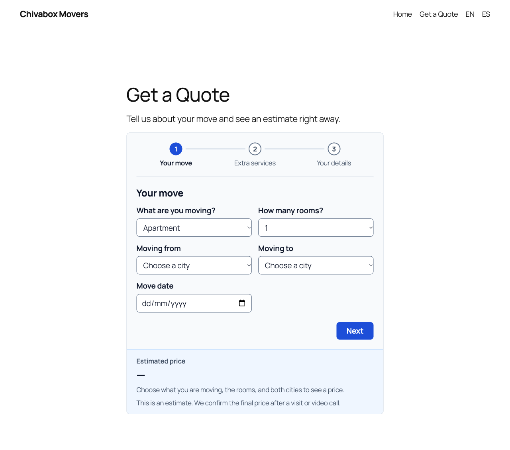 | 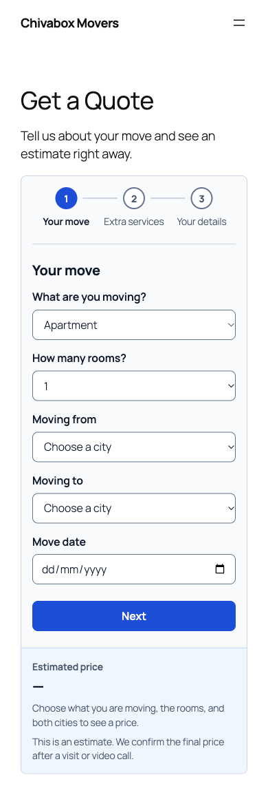 |
| Step 2, extra services, with a live estimate | 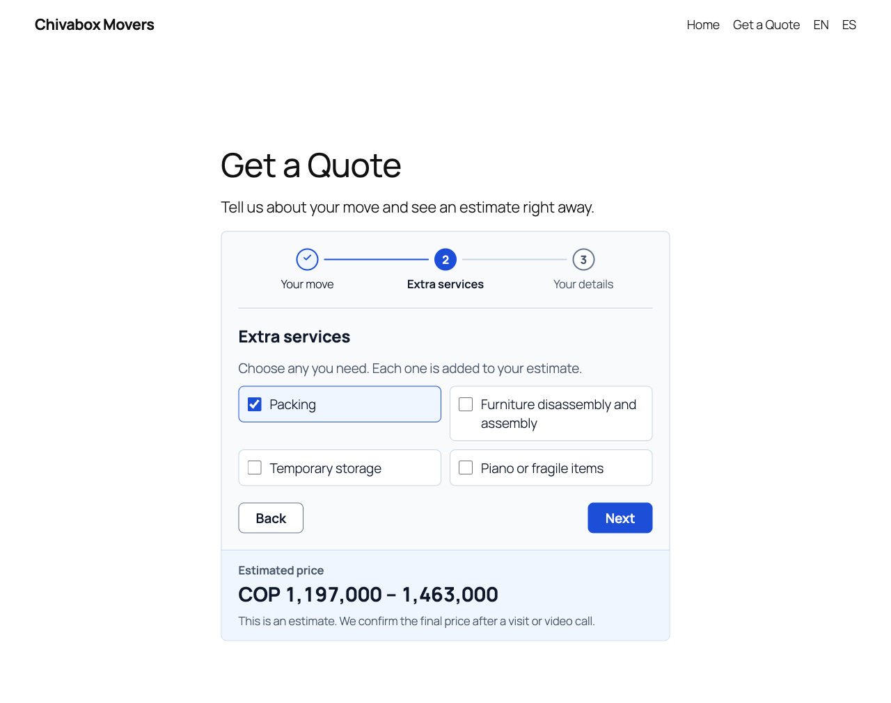 | 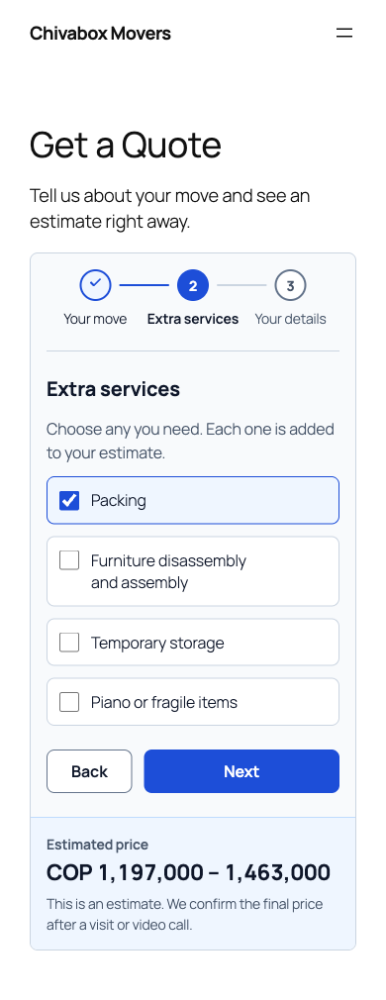 |
| Step 3, your details, with the estimate | 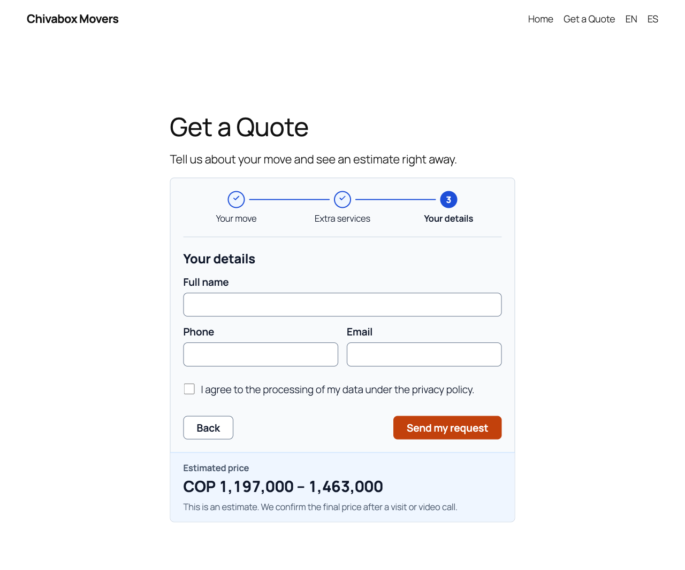 | 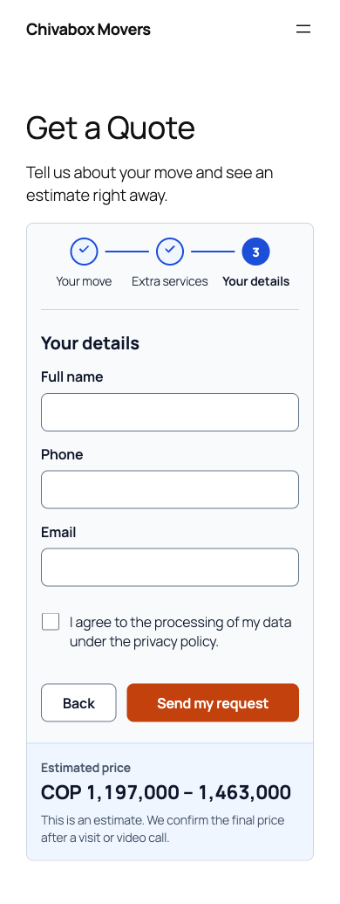 |
| A validation error from the server | 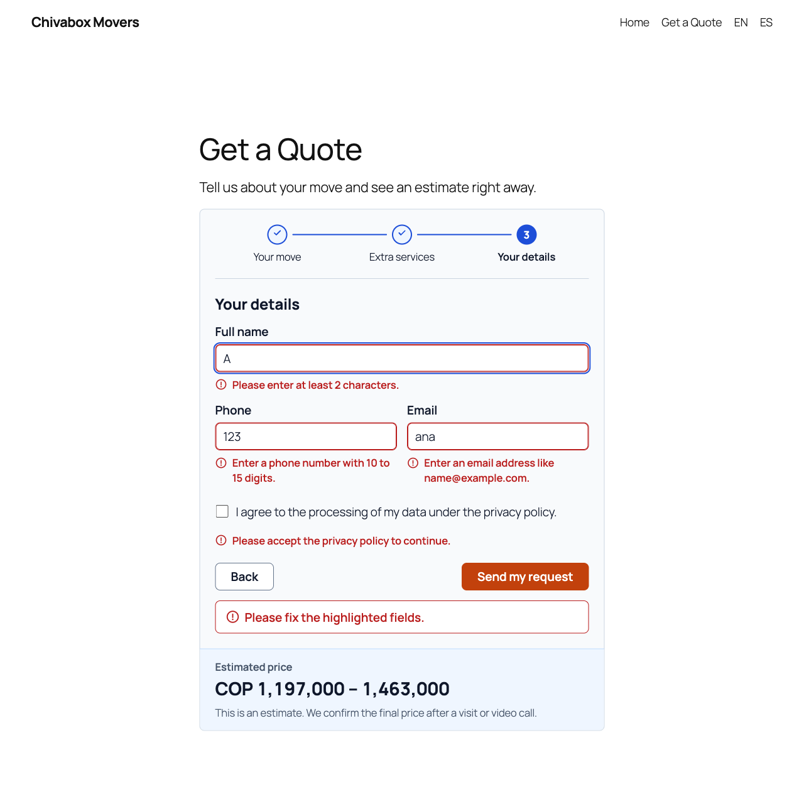 | 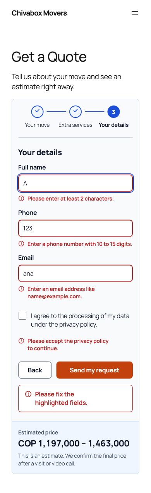 |
| The thank-you page | 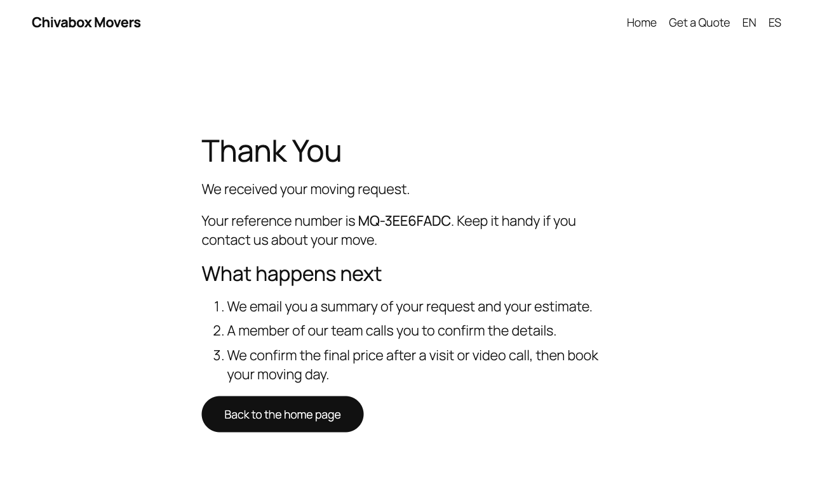 | 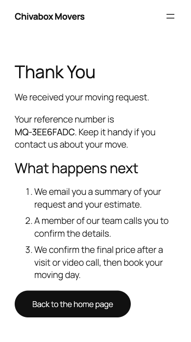 |
| Moving quotes → Leads | 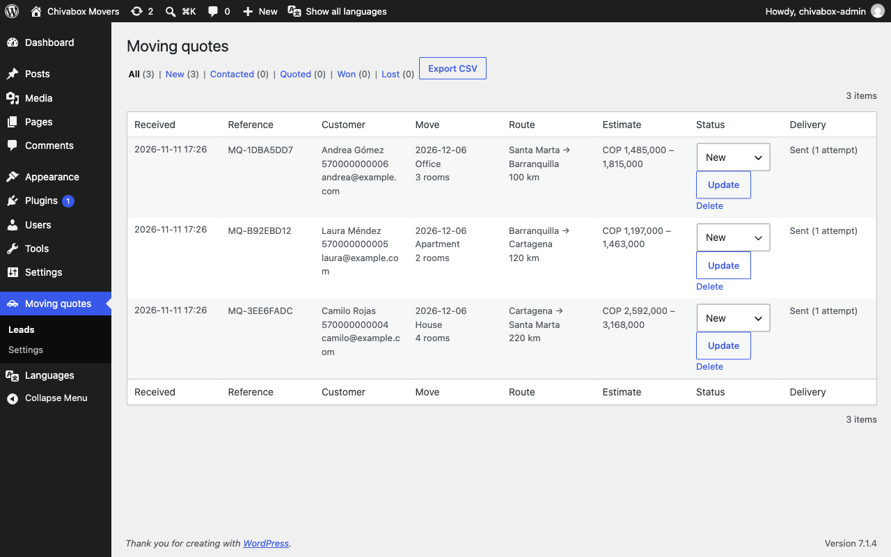 | 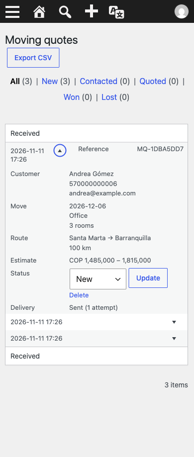 |

The form's colors, contrast ratios, and spacing are listed under "The quote form's design tokens" in [`docs/architecture.md`](docs/architecture.md).

## Quick start

```sh
pnpm install --frozen-lockfile
node scripts/init-env.ts && cp config/config.example.json config/config.json
docker compose up -d --wait
./setup.sh
pnpm run setup
```

Once the stack is up:

- WordPress: <http://localhost:8080>, in Spanish at <http://localhost:8080/es/>
- WordPress admin: <http://localhost:8080/wp-admin/>, with `WP_ADMIN_USER` and `WP_ADMIN_PASSWORD` from `.env`
- n8n: <http://localhost:5678>

`./setup.sh` builds the site in both languages, with English as the default. It downloads Polylang and WordPress's Spanish language pack, so it needs network access. `pnpm run setup` imports the n8n credentials and publishes the three workflows; until the Google values are in `.env` (see Configuration), it skips the two Google credentials, and `process-lead` stops at its Google Sheets step.

**One stack at a time.** Every demo in this series binds `127.0.0.1:5678`, and this one also binds `127.0.0.1:8080`. Run `docker compose ls` first, and stop any other demo's stack before bringing this one up.

**Upgrading an existing stack.** A stack from before `db/migrations/` existed follows "The one-time upgrade for an existing local stack" in [`docs/database.md`](docs/database.md). A stack from before the language switcher needs `docker compose up -d --wait` first, so the WordPress containers mount `site/mu-plugins/`, then `./setup.sh`, which keeps the existing English pages and adds the Spanish ones and the switcher. An existing `Moving leads` sheet needs `request_uuid` added as its 16th header before the next lead, or every lead stops at "Append lead row" and raises the operator alert.

PHP runs only inside Docker; there's no local `php` or `composer`. `pnpm run php <command>` runs a command in the PHP tools container.

### Try it in Playground

No server needed: open the plugin in [WordPress Playground](https://playground.wordpress.net/?blueprint-url=https://raw.githubusercontent.com/aabv21/wordpress-moving-quote-plugin/main/playground/blueprint.json), or the same site [in Spanish](https://playground.wordpress.net/?blueprint-url=https://raw.githubusercontent.com/aabv21/wordpress-moving-quote-plugin/main/playground/blueprint.es.json). Each installs the plugin from this repository's `main`, creates the pages, and lands on the quote form with a working live estimate. Delivery to n8n stays off, and each shows one language, without the switcher.

To run the same thing against the plugin files on disk:

```sh
pnpm dlx @wp-playground/cli@3.1.61 server --php=8.3 --port=9400 --mount=./plugin/moving-quote:/wordpress/wp-content/plugins/moving-quote --blueprint=playground/blueprint.local.json
```

## Configuration

**A Google OAuth client**, in the Google Cloud console:

- Type "Web application", with the authorized redirect URI `http://localhost:5678/rest/oauth2-credential/callback`.
- The Google Sheets API and the Gmail API enabled.
- The OAuth consent screen published **in Production**. In Testing, Google expires refresh tokens after 7 days, which silences the sheet, both emails, and the operator alert at once.

**`.env`**, written by `node scripts/init-env.ts`, which generates every password and secret. Fill in by hand:

| Key | What it is |
|---|---|
| `GOOGLE_OAUTH_CLIENT_ID`, `GOOGLE_OAUTH_CLIENT_SECRET` | The OAuth client above. Run `pnpm run setup` again afterward to import the two Google credentials, then choose "Sign in with Google" on each in n8n. |
| `TEAM_EMAIL` | The team's inbox for new-lead emails. `./setup.sh` copies it into the plugin's settings. |
| `SITE_LOCALE` | The site's default language, `en_US` or `es_CO`. The other language lives under `/es/` or `/en/`. Rerunning `./setup.sh` with the other value switches an existing site, and rewrites the menu and button links it created so each language keeps pointing at its own pages. |

**The `Moving leads` sheet.** A spreadsheet with a tab named `Moving leads`, whose first row is exactly these 16 headers, in this order:

```text
received_at reference name phone email move_date move_type rooms origin destination distance_km extras estimate_cop estimate_low_cop estimate_high_cop request_uuid
```

Format the `phone` column as Plain text. `request_uuid` is how a retried run finds the lead's own row, so it updates that row instead of adding a second one.

**`config/config.json`**, read by n8n:

| Key | What it is |
|---|---|
| `google.leads_sheet_id` | The spreadsheet's ID, from its URL. |
| `google.leads_tab` | The tab name, `Moving leads`. |
| `alerts.error_email` | Where workflow-failure alerts go. |
| `team_locale` | The team email's and the alert's language, `en` or `es`. Anything else falls back to English, with a note in each email. |

**Rates and cities.** Moving quotes → Settings holds the base rate per move type, the per-room and per-km prices, each extra's price, the range percentage, and the city-to-city distances. Amounts are whole Colombian pesos and accept Colombian formatting: `4.500`, `4,500`, and `4500` all mean 4,500 COP.

**Real system cron.** The stack disables WP-Cron and runs a `cron` container instead. On a real server, add `define( 'DISABLE_WP_CRON', true );` to `wp-config.php`, then run the same command every minute from system cron:

```text
* * * * * wp cron event run --due-now --path=/var/www/html
```

**Behind a reverse proxy.** Rate limits key on `REMOTE_ADDR`, which is the proxy's address. Filter `moving_quote_client_ip` once `REMOTE_ADDR` is a trusted proxy; "Behind a reverse proxy" in [`docs/architecture.md`](docs/architecture.md) has a worked example.

## Test scenarios

Automated suites, each with its own section in [`docs/testing.md`](docs/testing.md):

- `pnpm test`: every TypeScript unit, the n8n Code nodes, the workflow pins, and the tooling.
- `pnpm test tests/dom`: the quote form driven in a DOM (happy-dom), against a fixture of the real markup.
- `pnpm run php composer check`: PHPCS, PHPStan level 9, and PHPUnit for every pure PHP class.
- `pnpm run test:stack:wp`: WordPress on the real stack, covering install, settings, the REST API, the form, the Leads admin, delivery, and both languages.
- `pnpm run test:stack:n8n`: the three workflows on the real stack, from a signed lead to the operator alert.
- The queue-mode run: `docker compose -f compose.yaml -f compose.queue.yaml up -d --wait --scale n8n-worker=2`, then `pnpm exec vitest run --config vitest.stack.config.ts tests/stack/n8n/intake.test.ts`.

By hand, on the local stack. A stack test already covers each scenario's WordPress half; these confirm the whole path with a real Google account:

| Scenario | Expected result |
|---|---|
| 1. Apartment, 2 rooms, Barranquilla → Cartagena, no extras, at `/get-a-quote/` | The form shows `COP 1,017,000 – 1,243,000`. One sheet row with the headers in order, `phone` as the text `570000000001`, and a formula-looking name as literal text. A plain-text team email with the subject `New lead MQ-…: Barranquilla to Cartagena on …`. A customer email that replies to the team address, with no n8n attribution. Leads shows it as Sent. |
| 2. House, 4 rooms, Cartagena → Santa Marta, every extra | `COP 2,592,000 – 3,168,000` in the form, in the row's `estimate_low_cop`/`estimate_high_cop`, and in both emails. |
| 3. `docker compose stop n8n`, submit scenario 1, then `docker compose start n8n` | The thank-you page appears at once. The lead is Pending with an error, then Sent within about 2 minutes. Exactly one row and one email pair. Covered for WordPress by `end-to-end.test.ts`'s n8n-stopped case. |
| 4. Moving quotes → Settings, set the webhook secret to any other 32+ characters, then submit | Delivery shows `HTTP 403` and nothing reaches the sheet. `./setup.sh` restores the secret from `.env`; "Retry delivery" then sends it, once. Covered for WordPress by `end-to-end.test.ts`'s wrong-secret case. |
| 5. In dev tools, `document.querySelector('[name=website]').value = 'x'`, then submit | The thank-you page shows, but there's no lead and no row. Covered by `quote-api.test.ts`'s honeypot case. |
| 6. Moving quotes → Settings, per km `5.000` | Scenario 1 shows `COP 1,125,000 – 1,375,000`. Restore `4.000`. |

### Live checks (need a Google account)

Set up, in order:

1. The OAuth client, as in Configuration: the redirect URI, both APIs enabled, and the consent screen in Production.
2. `.env`: `GOOGLE_OAUTH_CLIENT_ID`, `GOOGLE_OAUTH_CLIENT_SECRET`, and `TEAM_EMAIL`.
3. The spreadsheet with its `Moving leads` tab and the 16 headers above (`phone` as Plain text), and `config/config.json`'s `google.leads_sheet_id`, `google.leads_tab`, `alerts.error_email`, and `team_locale`.
4. `docker compose up -d --wait`, `./setup.sh`, then `pnpm run setup`. Add `pnpm run setup -- --refresh cvbCredGmail0001` only if the Gmail credential was imported before it was narrowed to send-only.
5. In n8n, "Sign in with Google" on both Google credentials. Gmail's consent screen must ask only to send email.
6. The sender's display name: Gmail → Settings → Accounts → "Send mail as" → edit the name.

Then:

| Check | Expected result |
|---|---|
| Scenarios 1–6 above | As listed. |
| Switch to ES in the header, then send scenario 1 from `/es/cotizar/` | Lands on `/es/gracias/?reference=MQ-…`. The lead's CSV row has `es_CO`. The customer email is `Su cotización de mudanza de …` with `COP 1.017.000 – 1.243.000`. With `team_locale: "en"` the team email is English; with `"es"`, the next one is `Nueva solicitud MQ-…`. |
| Set `team_locale` to `"ES"`, submit, then restore it | The team email is English and ends with `Note: config.team_locale is not "en" or "es"…`. The customer email is still in the lead's language. |
| Rename the `Moving leads` tab, then submit scenario 1 | After 3 tries, one `[Chivabox demo] Workflow failed: Process lead` email reaches `alerts.error_email`, naming "Append lead row". Rename the tab back and choose Retry on the failed execution in n8n's executions list: it resumes at "Append lead row", adds the row, and sends both emails. n8n then hides Retry on that execution, so retry it once more through n8n's API: create a key in n8n under Settings → n8n API, run `read -rs N8N_API_KEY && export N8N_API_KEY` and paste it, then `curl -fsS -X POST -H "X-N8N-API-KEY: $N8N_API_KEY" -H 'Content-Type: application/json' -d '{}' http://localhost:5678/api/v1/executions/<execution id>/retry`, with the failed execution's ID from its URL. It answers with `"mode":"retry"`. Still one row for that lead, updated in place by its `request_uuid`, and both emails again: each retry resends the team and customer emails. |
| The same with `team_locale: "es"`, then restore it | The subject is `[Chivabox demo] Falló el flujo: Process lead`, with Spanish labels. |
| With both Google credentials signed in, `pnpm run test:stack:n8n` | Every case that would reach `process-lead` or `error-handler` prints its skip message. No test row and no email. |
| The Gmail consent and the sender name | The consent is send-only, and the sender name shows on both emails. |
| Both Playground links above, once this version is on `main` | `blueprint.json` installs from GitHub, and `blueprint.es.json` shows the Spanish pages and form. |

## Design decisions

Each is explained in full under "Decisions" in [`docs/architecture.md`](docs/architecture.md).

- **JWT over a hand-rolled HMAC header.** n8n's Webhook node verifies HS256 natively, so the secret stays in an n8n credential and a bad token never starts an execution.
- **The leads table is the outbox.** WordPress saves the lead first and sends it second, so an n8n outage delays a lead but never loses it.
- **`jti` dedupe in Postgres.** One UUID is the lead's key, the token's `jti`, and the `processed_events` key, so a retried delivery is recorded once.
- **Append or update by `request_uuid`, in `RAW` cells.** A retried run updates the lead's own row instead of adding a second, and phones and formula-looking names stay text.
- **Append before email.** No email goes out for a lead that isn't in the sheet.
- **A plain-text team email.** It's built from visitor input, so it carries no `tel:` or `mailto:` links a crafted address could abuse.
- **Polylang as a soft dependency.** The plugin follows whatever language a page is in and works without Polylang.
- **Alerts in the team's language.** The team email and the operator alert both follow `team_locale`, and an invalid value never blocks either.
- **Scaling.** `compose.queue.yaml` switches n8n to queue mode, with Redis and workers; see "Scaling" in [`docs/architecture.md`](docs/architecture.md).

## Limitations

- **Rate limits are per IP and fixed-window.** Visitors behind one shared NAT share one budget (5 submissions an hour by default). Upgrade: a per-visitor token, or a CAPTCHA.
- **A page cache can serve a stale nonce**, and the form then answers "Your session expired". Upgrade: exclude the quote page from the cache.
- **Distances are approximate**, from a fixed city-to-city table in Settings. Upgrade: a routing API.
- **WordPress and n8n need synced clocks (NTP)** when they run on different hosts: a token lives 300 seconds, with 60 seconds of allowed skew.
- **The webhook secret is stored in the database.** Upgrade: a `wp-config.php` constant.
- **Single site only.** Multisite activation is refused.
- **Playground runs without delivery and in one language**, since it has no n8n and no Polylang.
- **An email can still double on a retry.** A retry after Gmail sent but before n8n saw the answer resends it; the sheet row can't double. Duplicates are found by the `MQ-…` reference in the subject.
- **Append before email, and one shared OAuth client.** A failed append sends no email, and an expired Google grant silences the sheet, both emails, and the alert at once.
- **A false duplicate.** A lost acknowledgement from Postgres can make a new lead read as a replay, so it never reaches the sheet. "Recovering a false duplicate" in [`docs/architecture.md`](docs/architecture.md) has the commands.
- **The sheet lookup grows with its rows.** Each run reads the `request_uuid` column to find a match, which is fine for tens of thousands of leads. Upgrade: a keyed store checked before writing.
- **Twenty Twenty-Five's own strings stay English in Spanish**, such as its footer: they come from the theme's language pack, which this demo doesn't install.
- **`./setup.sh` needs network access** to download Polylang and WordPress's Spanish language pack.
- **A site first set up in Spanish before the language switcher keeps Spanish copy on its English pages.** Those pages (English slugs, Spanish text) get tagged English. To fix one, delete the `home`, `get-a-quote`, and `thank-you` pages and the `primary-navigation` menu (`docker compose exec -T wpcli wp post delete <id> --force`), then rerun `./setup.sh`, which recreates them in English.

## License

[MIT](LICENSE).
